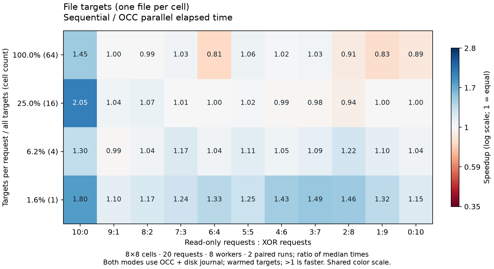
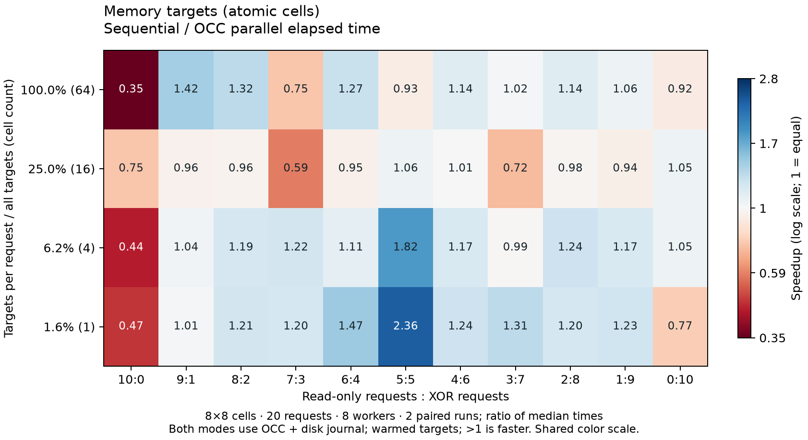

# Matrix benchmark grid

Two heatmaps compare file-backed and memory-backed targets. Each number is
**sequential elapsed time / parallel OCC elapsed time**. Above 1× is faster.

- X: read-only requests : XOR requests, from 10:0 to 0:10.
- Y: targets touched per request / total targets. Both request types use the same
  number of targets. An XOR request reads and writes every selected cell.
- Baseline: the same OCC Manager with one worker, including validation, backups,
  journal and storage flushes. This is not a comparison against raw, unprotected
  sequential access.

The original animated matrix demo remains unchanged.

## Run

From the matrix-demo module directory:

```sh
go run ./cmd/matrix-bench -n 16 -requests 100 -workers 8 \
  -repeats 3 -warmups 1 -out /tmp/matrix-bench-full
```

The output directory must be new or empty. Plotting requires Python 3 and
Matplotlib (`python3 -m pip install matplotlib`). Use `-plot=false` to collect
measurements without Python, then run `python3 OUTPUT/plot.py OUTPUT` later.

A smaller exploratory run:

```sh
go run ./cmd/matrix-bench -n 8 -requests 20 -workers 8 \
  -coverage 0.015625,0.0625,0.25,1 -repeats 2 -warmups 0 \
  -out /tmp/matrix-bench-small
```

Files: `file.png`, `memory.png` (also SVG), `raw.csv`, `summary.csv`, and
`metadata.json`. CSV rows include durations, actual rounded coverage, attempt
counts, paired-speedup quartiles and seeds. Each heatmap uses **median sequential time / median OCC time**;
the two charts share a logarithmic color scale centered at 1×.

| Option | Default | Meaning |
|---|---|---|
| `-n` | 16 | Matrix side; total targets = n² |
| `-requests` | 100 | Requests per sample; a multiple of 10 |
| `-workers` | 8 | Parallel workers; baseline always uses 1 |
| `-read-parts` | 10,9,…,0 | Read parts out of ten |
| `-coverage` | .01,.05,.1,.25,.5,1 | Fraction of targets per request |
| `-repeats` | 3 | Measured pairs per point |
| `-warmups` | 1 | Unmeasured pairs per point |
| `-seed` | 42 | Seed + repeat index; shared across each pair/backends |
| `-retries` | 4 | Optimistic retries before exclusive fallback |
| `-work-delay` | 0s | Wait per command attempt, after private work and before validation; e.g. 5ms |
| `-jitter` | true | Randomize retry waits |
| `-timeout` | 10m | Maximum time per sample; errors stop the run |

## What is measured

**File:** each cell is a separate one-byte file. Reads open/read/close the file;
writes open/write/Sync/close. **Memory:** one shared matrix of atomic cells, with
no global adapter lock. Individual cells are race-safe; OCC provides transaction
validation. Memory target data is not restart-persistent.

**Both backends still use OCC's disk journal and backups.** The memory chart is
not an entirely in-memory transaction engine. File runs warm all targets before
timing and do not bypass the OS cache. No artificial work delay is added by default. `-work-delay 5ms` sleeps inside
each worker after successful command execution, before OCC validation. It applies
to reads and writes in both modes, including retries and exclusive fallback, and
is included in timing. It simulates waiting, not CPU computation. The worker
cannot take another request until the current request finishes.

Every sample is a fresh process with its own data and `.occ` directory under the
output directory. Initialization, command generation, target warming, final
verification and final cleanup waiting are excluded. Worker dispatch, actual
commands, retries, exclusive fallback and synchronous commit work are included.
Background journal cleanup may overlap execution; remaining cleanup is drained
before the next sample. Process startup is not timed. Mode order alternates within
each point, and requests are shuffled reproducibly. The requested ratio describes
the workload, not the instantaneous mix among active workers.

The workload uses uniformly selected distinct targets, not contiguous blocks.
No parity-correction commands are added: they would change the read/write ratio.
Instead, every final cell is checked against the expected XOR of all writes.
Read results are checked for shape and binary values; this benchmark alone does
not prove serializability of every intermediate snapshot.

`extra_attempts` counts executions beyond the first, including exclusive fallback;
it is not a direct conflict counter. Small all-read samples can finish in
microseconds and are noisy. Use more requests/repeats before drawing conclusions.
The small run is a smoke experiment, not a stable performance claim.

```sh
go test -race ./cmd/matrix-bench
```

## Recorded exploratory run

An 8×8 matrix, 20 requests, 8 workers, 2 measured pairs, and no warmup pairs.
Coverage: 1, 4, 16, or 64 cells per request. All 11 read/write ratios were tested
on both backends: 352 samples across 88 points. Every sample passed final XOR
verification. These small samples illustrate the benchmark; use larger runs for
performance conclusions.





[Raw measurements](../../benchmark-results/2026-10-30-smoke/raw.csv) ·
[Summary](../../benchmark-results/2026-10-30-smoke/summary.csv) ·
[Run metadata](../../benchmark-results/2026-10-30-smoke/metadata.json)

## Resume an interrupted run

Repeat the original command with the same settings and output directory, adding
`-resume`. Completed samples are reused; missing samples run in fresh processes.
A partial final CSV line is discarded. Parameters must match the saved metadata.
The output directory is locked against concurrent benchmark writers. Summary and
plots are rebuilt from all measurements. Resuming across sessions can introduce
changes in machine load; keep that in mind when interpreting results.

## Overlap heatmap

```sh
go run ./cmd/matrix-bench -n 16 -requests 10 -workers 10 \
  -overlap 0.1,0.3,0.6,0.9 -read-parts 10,5,0 \
  -work-delay 10ms -repeats 1 -warmups 0 \
  -out /tmp/matrix-overlap-smoke
```

`-overlap` overrides coverage and requires `workers=requests`. For M targets,
C requests and k distinct uniformly sampled targets per request:

```
q = choose(M-k, k) / choose(M, k)
p = 1 - q^(C-1)
```

This is the probability that one request shares any target with any other request
in the initial batch, regardless of read/write type. It is not the measured
conflict rate or a guarantee of simultaneous CPU execution. Read/read overlap
still counts. For 2k > M, q is zero; for C = 1, p is zero.

The runner selects the nearest integer k for each requested probability; the
Y axis shows the actual theoretical probability and k. Duplicate k values are
rejected. Metadata retains both requested and actual probabilities. A nonempty
uniform sample cannot always attain 0% overlap.

Color and cell labels use median sequential time / median parallel time, with
a shared logarithmic color scale centered at 1. Values above 1 mean faster parallel
execution. Both modes use identical jobs and delays. Existing result metadata
with `heatmap_metric: normalized_time_difference` can still render the score view.

One repeat is only a smoke check, not a stable performance estimate. Example:
[file heatmap](../../benchmark-results/2026-10-31-overlap-speedup/file.png) and
[memory heatmap](../../benchmark-results/2026-10-31-overlap-speedup/memory.png).
